# Hi Github, Xiyu here
## About me
I'm an undergraduate in Mathematics and student at 42 School.

## Technical Skills

  

### Languages

  
  
  
  
  
  
  
  
  
  
  

### Document writing

  
  
  
  
  
  
  

### Other tools

  
  
  
  

## Contribution table 👋

<picture data-importer="pacman">
  <source media="(prefers-color-scheme: dark)" srcset="https://raw.githubusercontent.com/seeyouwhoosh/seeyouwhoosh/pacman-output/pacman-contribution-graph-dark.svg?game=pacman">
  <source media="(prefers-color-scheme: light)" srcset="https://raw.githubusercontent.com/seeyouwhoosh/seeyouwhoosh/pacman-output/pacman-contribution-graph.svg?game=pacman">
  
</picture>

###

